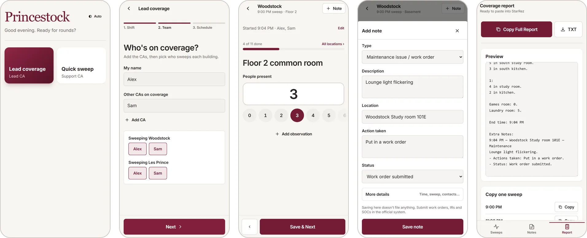

# SweepMate

**An offline-first app for overnight residence rounds: walk the route, record every room, and get a report ready to paste into StarRez.**

[](.github/workflows/ci.yml)

> **Status:** Live and in use on real overnight shifts, and in the process of becoming an official McMaster tool for residence Community Advisors. The live link is shared privately with the CAs who use it.

[Why I built it](#why-i-built-it) · [What it does](#what-it-does) · [Privacy by design](#privacy-by-design) · [Engineering](#engineering) · [Run locally](#run-locally)

## Why I built it

I'm a residence Community Advisor (CA). Overnight coverage means sweeping the buildings several times a night: walking every floor, counting the people in each shared space, noting maintenance issues and anything else worth recording. At the end of the shift, all of it goes into a coverage report in StarRez, the residence system.

In practice, that meant scribbling counts into a phone's notes app while walking, then retyping everything into StarRez's format at the end of a long night, when details are easiest to lose. The notes also stayed on personal phones and cloud accounts long after the report was filed.

I built SweepMate to solve a problem I had myself. It guides each round room by room, captures details where they happen, and turns them into a consistent, ready-to-paste report, with nothing stored anywhere but the phone.

## What it does

<p align="center">
  
</p>
<p align="center"><sub>Home · Shift setup · Recording a room · Adding a note · The finished report (fictional data)</sub></p>

- **Guided rounds:** one location at a time, in each building's real walking order. Tap a count or type it in. An empty room is a real **0**, and a skipped room stays visibly blank.
- **Overnight-aware schedule:** sweeps after midnight stay with the shift they belong to. Sweeps can be added mid-shift without losing recorded data.
- **Notes as they happen:** maintenance issues, incident reports, students of concern and follow-ups, each timestamped and tied to its sweep, with a status like "work order submitted".
- **One-tap reporting:** copy the whole night, or a single sweep, in the exact StarRez format. Anything missing is flagged as `[not recorded]`, never guessed.
- **Two roles:** **Lead coverage** for the CA running the night, and **Quick sweep** for support CAs helping with a single building.
- **Built for the job:** installable to the home screen, works with no signal in basements and stairwells, large touch targets, and light and dark themes.

## Privacy by design

SweepMate handles notes about residence life, so it's built to keep them on the CA's phone:

- **No backend.** There's no server, database, account or analytics. The app is static files, and at runtime it makes no network requests: no `fetch`, no third-party scripts, no tracking.
- **Data stays on the device.** Shifts are saved in the browser's local storage on the phone that recorded them, and nowhere else.
- **Offline-first.** A service worker precaches the app, so a full shift works in airplane mode, which is only possible because nothing needs a server.
- **Out of sight.** The live deployment is shared privately and marked `noindex`, so it doesn't appear in search engines.

## Engineering

**React 19 · TypeScript · Vite · Tailwind CSS v4 · PWA (Workbox) · Vitest · React Testing Library**

The engineering follows the realities of the shift: preserve what was observed, adapt to each building, and keep the report correct as the night changes.

| Decision | Why it matters | Implementation |
| --- | --- | --- |
| Model **zero**, **skipped** and **unanswered** as distinct states | The report reflects what actually happened; a blank is never silently saved as 0 | [Types](src/domain/types.ts), [progress](src/domain/progress.ts), [report tests](src/domain/report.test.ts) |
| Keep **route configuration separate from report layout** | Les Prince alternates wings while walking downstairs, but every floor reports north-first | [Building config](src/config/buildings.ts), [route generation](src/domain/route.ts) |
| Keep **sweep records intact when the schedule changes** | Adding or moving a sweep mid-shift retains its counts, CAs and notes | [Shift operations](src/domain/shift.ts), [regression test](src/screens/Overview.test.tsx) |
| **Normalize saved data at the storage boundary** | Records from older versions load safely, and damaged data is backed up instead of discarded | [Storage](src/domain/storage.ts), [migration tests](src/domain/storage.test.ts) |
| **Offline-first with no server** | Precached app shell; every entry autosaves locally; updates wait for a tap so a new version never reloads mid-round | [PWA config](vite.config.ts), [update prompt](src/components/UpdatePrompt.tsx), [store](src/state/store.tsx) |

**Testing:** 68 automated tests cover routes, overnight time handling, schedule edits, storage migrations, exact report output, and full UI workflows driven through React Testing Library. [CI](.github/workflows/ci.yml) runs lint, tests and a production build on every push and pull request. See the [testing guide](docs/testing.md).

### Suggested code-review path

1. [Data model](src/domain/types.ts): how shifts, sweeps, building records and location answers relate.
2. [Route generation](src/domain/route.ts) and [configuration](src/config/buildings.ts): one walkthrough supports both fixed and alternating building layouts.
3. [Schedule operations](src/domain/shift.ts): retained sweep IDs preserve answers when the schedule changes.
4. [Report generation](src/domain/report.ts): recorded state becomes consistent text without silently filling missing details.
5. [Quick-sweep workflow tests](src/screens/QuickSweep.test.tsx): a complete route, edits, the report, resuming and deleting, all through the UI.

The [architecture guide](docs/architecture.md) explains the data flow and tradeoffs.

## Run locally

No keys, accounts or database are needed. Use **Node.js 24** (see `.nvmrc`):

```bash
git clone https://github.com/Erunixz/SweepMate.git
cd SweepMate
npm ci
npm run dev
```

Open the address Vite prints, usually `http://localhost:5173`. To try it on a phone on the same network, run `npm run dev -- --host`.

| Command | Purpose |
| --- | --- |
| `npm run dev` | Start the development server |
| `npm test` | Run the test suite once |
| `npm run typecheck` | Check TypeScript |
| `npm run lint` | Run ESLint |
| `npm run build` | Type-check and build into `dist/` |
| `npm run preview` | Serve the production build locally |

## Project structure

```text
src/
  config/       Building routes, schedules, note kinds, report wording
  domain/       Data types, shift operations, time, routes, reports, storage
  state/        React context, autosave, navigation, preferences
  components/   Shared controls, location entry, dialogs, navigation
  screens/      Setup, overview, walkthrough, notes, report, home
  test/         Shared test environment
docs/           Architecture, testing and deployment guides
```

## License

[MIT](LICENSE) © Erfan Zamani
