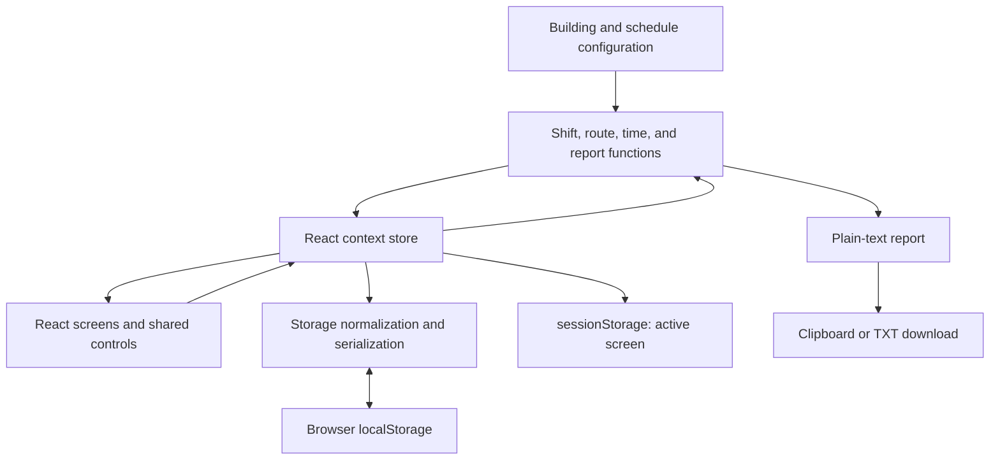

# Architecture

SweepMate is a client-rendered React application. Its domain functions are separate from rendering, and its persistent model is plain JSON. The core workflow requires no network API.

## Data flow



[App.tsx](../src/App.tsx) selects a screen using a discriminated `View` union. [store.tsx](../src/state/store.tsx) owns shifts, the active record, navigation, and save status. Components keep transient form drafts locally and write changes through domain functions.

## Recording model

```text
Shift
  mode: full | quick
  quickBuildingId: building ID | null
  date, schedule metadata, CA defaults
  sweeps[]
    id, scheduledTime
    buildings[buildingId]
      actualStart, actualEnd, cas
      entries[locationId]
  notes[]
  extraNotes, reportDraft
```

An absent location entry means unanswered. An answered entry can contain a real count of zero. Reports show these as the recorded value or `[not recorded]`. The walkthrough's Skip button moves on without writing anything. A skipped entry (the former Not Checked button) can still appear in older records and is reported as `[not checked]`.

Counts belong to a specific sweep and building. No operation uses a previous sweep's answers to prefill another sweep. Building CAs use an explicit per-sweep override when supplied, otherwise the shift's building defaults. `null` means use defaults; an empty override means no names are recorded.

## Walking routes and reports

[buildings.ts](../src/config/buildings.ts) describes both routes:

- **Woodstock, 11 locations:** common rooms on Floors 6 through 2, basement study rooms 101E and 101C, laundry, games, first-floor north kitchen, and Floor 1 common room.
- **Les Prince, 24 locations:** Floors 6 through 2 alternate which wing is visited first, beginning south-first on Floor 6. Floor 1 has one study room and kitchen, followed by games and laundry.

[route.ts](../src/domain/route.ts) flattens those layouts into stable location IDs. The report uses `reportBlocks`, independently of walking order. Les Prince always prints north study, north kitchen, south study, and south kitchen on separate lines under each floor heading. Full reports list Woodstock before Les Prince.

Do not rename location IDs during a route reorder. Existing answers are keyed by ID, not by array position. Route tests verify that every location appears exactly once in its report layout.

## Overnight schedules and identity

[time.ts](../src/domain/time.ts) interprets a time earlier than the shift start as belonging to the next calendar day. A 9 PM, 11 PM, 1 AM schedule therefore stays in shift order rather than clock order. This is a local-time, single-overnight-shift model, not a timezone-aware calendar scheduler.

`applySchedule` retains sweeps by ID, changes their scheduled times, creates empty records for new rows, and sorts the result relative to the shift start. Notes attached to a removed sweep become shift-level notes. The overview rejects duplicate times before applying its update.

## Full coverage and Quick sweep

Quick sweep creates one sweep and records one building ID on the same Shift model. `shiftBuildings` restricts its progress, missing-data checks, and navigation to that building. The shared walkthrough records counts, notes, CAs, and actual times. The report omits the coverage header.

Older stored shifts normalize to `mode: 'full'` and `quickBuildingId: null`. Invalid quick-building IDs or quick records without exactly one sweep are rejected during normalization.

## Persistence and recovery

| Storage | Key | Contents |
| --- | --- | --- |
| localStorage | `sweepmate:v1:shifts` | Real shifts in a versioned envelope |
| localStorage | `sweepmate:v1:demo` | Former demo record; removed on load |
| localStorage | `sweepmate:v1:backup-*` | Best-effort raw backups when damaged shift data is detected |
| localStorage | `sweepmate:schedules` | Former saved schedule defaults; no longer read |
| localStorage | `sweepmate:report-template` | Former report wording overrides; no longer read (the StarRez format is fixed) |
| localStorage | `sweepmate:theme` | Theme preference |
| sessionStorage | `sweepmate:v1:session` | Active shift ID and screen within the current tab |

The store serializes changed records and writes them after state updates. [storage.ts](../src/domain/storage.ts) normalizes older fields, filters invalid data, and reports unavailable or damaged storage. Backup writes are best-effort and may fail if storage is full. There is no backup-restoration UI.

This keeps setup small but has limits: saves serialize the shift collection synchronously, tabs do not coordinate writes, and large histories could require a different persistence strategy. Browser storage does not provide application-level encryption or authorization.

## Report editing

[report.ts](../src/domain/report.ts) generates text from recorded state and the fixed StarRez template. A user-edited `reportDraft` takes precedence over generated text. Changes to counts do not silently overwrite that draft; regeneration is explicit. Copy/download both use the resulting text.

## Interface decisions

Shared controls provide labels, focus indicators, status text, and large interaction targets. Native `dialog` elements provide modal focus behavior and Escape handling. Collapsed sweep panels are inert and hidden from assistive technology. Animations honor `prefers-reduced-motion`.

These are implementation choices, not a claim of audited accessibility compliance. [Manual verification](testing.md#manual-browser-checks) remains part of UI review.

## Scope and future work

- Records are local to a browser and origin. There is no cross-device sync or coordinated multi-tab editing; the last tab to save wins.
- Browser storage is not an encrypted records vault. Clearing site data removes records, and TXT download exports a report rather than a restorable application backup.
- Notes about maintenance, Incident Reports, and Students of Concern do not submit anything to an official system.
- User-edited report text stays unchanged until explicitly regenerated, even when the underlying counts change.
- The app has no service worker or guaranteed offline reload. Its state-based navigation does not provide shareable screen URLs.
- Automated checks run in Vitest/jsdom; real-device visual verification and accessibility auditing remain separate tasks.

Potential next steps include a restorable data export/import format, real-browser regression tests, and an explicit multi-tab conflict strategy. These are future work, not shipped features.

## Where to make changes

| Change | Entry point |
| --- | --- |
| Buildings, walking order, report room wording | [buildings.ts](../src/config/buildings.ts) |
| Default sweep times | [schedules.ts](../src/config/schedules.ts) |
| Report headings and placeholders | [reportTemplate.ts](../src/config/reportTemplate.ts) |
| Note kinds and status wording | [noteKinds.ts](../src/config/noteKinds.ts) |
| New stored fields and migrations | [types.ts](../src/domain/types.ts), [storage.ts](../src/domain/storage.ts) |
| Theme and motion | [index.css](../src/index.css) |
